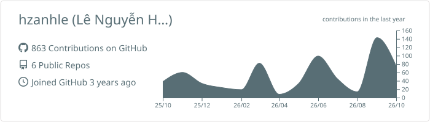
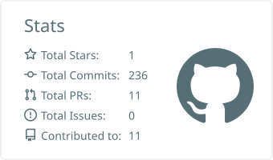
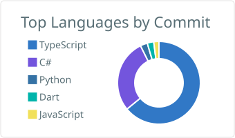
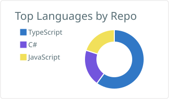
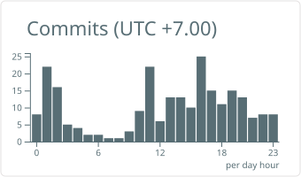

<!-- Header -->

  

<h3 align="center">
  Hi there, I'm Hoàng Anh 
</h3>

  

  
  
  

---

##  About me

I'm a fullstack developer based in Ho Chi Minh City, finishing my Software Engineering degree at **FPT University** (class of 2026). Most of my work lives in **C# / .NET** and **TypeScript**: React and Next.js on the front, ASP.NET Core or NestJS behind it.

Lately I've been having fun wiring AI into real products. Most recently that was **HCMRainVision**, which reads public traffic cameras to show where it's raining across the city. I'm also digging deeper into system design and cloud, mostly on **AWS** through the First Cloud Journey program.

When I'm not doing that, I make Roblox games in Lua. If you're building something fullstack or AI-related, I'd love to hear about it.

---

##  What I work with

<table align="center">
  <tr>
    <td align="center" width="170"><b>Languages</b></td>
    <td></td>
  </tr>
  <tr>
    <td align="center"><b>Frontend & Mobile</b></td>
    <td></td>
  </tr>
  <tr>
    <td align="center"><b>Backend</b></td>
    <td></td>
  </tr>
  <tr>
    <td align="center"><b>Data</b></td>
    <td></td>
  </tr>
  <tr>
    <td align="center"><b>Cloud & Tools</b></td>
    <td></td>
  </tr>
</table>

---

##  Things I've built

<table>
  <tr>
    <td width="50%" valign="top">
      <h3> HCMRainVision</h3>
      
Real-time rain &amp; traffic monitoring for Ho Chi Minh City. Crawls public traffic cameras, classifies rain level with Vision AI (Qwen), and pushes live updates to web &amp; mobile via SignalR and FCM.

      

        
        
        
        
        
      

      Team of 2 · Top contributor (46 commits) · Private repo
    </td>
    <td width="50%" valign="top">
      <h3> Martial Arts Tracker</h3>
      
AI-powered martial arts training platform for fighters, coaches and doctors. Videos are analyzed by a YOLO-Pose worker through a Redis job queue to score kicking technique.

      

        
        
        
        
        
      

      Team of 4 · Top contributor (137 commits) · Private repo
    </td>
  </tr>
  <tr>
    <td width="50%" valign="top">
      <h3> EV Station-Based Rental</h3>
      
Full-stack platform for renting electric vehicles across stations: OTP sign-up, multi-step booking, digital contracts and online payments with VNPay &amp; PayOS.

      

        
        
        
        
      

      
       Team of 4 · 113 commits
    </td>
    <td width="50%" valign="top">
      <h3> Waste Collection System</h3>
      
Role-based platform connecting citizens, operators and collectors for urban waste reporting, with AI-assisted waste classification, task tracking and a rewards &amp; vouchers system.

      

        
        
        
        
      

      Team of 4 · Top contributor (64 commits) · Private repo
    </td>
  </tr>
  <tr>
    <td colspan="2" valign="top">
      <h3> AutoWash</h3>
      
Car wash management web app with phone-number sign-in, built on the latest Next.js App Router and a NestJS REST backend.

      

        
        
        
        
      

      
      
       Team of 3 · Top contributor (38 commits)
    </td>
  </tr>
</table>

---

##  GitHub activity

  <picture>
    <source media="(prefers-color-scheme: dark)" srcset="profile-summary-card-output/tokyonight/0-profile-details.svg" />
    
  </picture>

  <picture>
    <source media="(prefers-color-scheme: dark)" srcset="profile-summary-card-output/tokyonight/3-stats.svg" />
    
  </picture>
  <picture>
    <source media="(prefers-color-scheme: dark)" srcset="profile-summary-card-output/tokyonight/2-most-commit-language.svg" />
    
  </picture>

  <picture>
    <source media="(prefers-color-scheme: dark)" srcset="profile-summary-card-output/tokyonight/1-repos-per-language.svg" />
    
  </picture>
  <picture>
    <source media="(prefers-color-scheme: dark)" srcset="profile-summary-card-output/tokyonight/4-productive-time.svg" />
    
  </picture>

  <picture>
    <source media="(prefers-color-scheme: dark)" srcset="https://streak-stats.demolab.com?user=hzanhle&theme=tokyonight&hide_border=true&ring=A78BFA&fire=7C3AED&currStreakLabel=A78BFA&date_format=j%20M%5B%20Y%5D" />
    
  </picture>

---

##  Contribution snake

  <picture>
    <source media="(prefers-color-scheme: dark)" srcset="https://raw.githubusercontent.com/hzanhle/hzanhle/output/github-snake-dark.svg" />
    <source media="(prefers-color-scheme: light)" srcset="https://raw.githubusercontent.com/hzanhle/hzanhle/output/github-snake.svg" />
    
  </picture>

<!-- Footer -->

  

